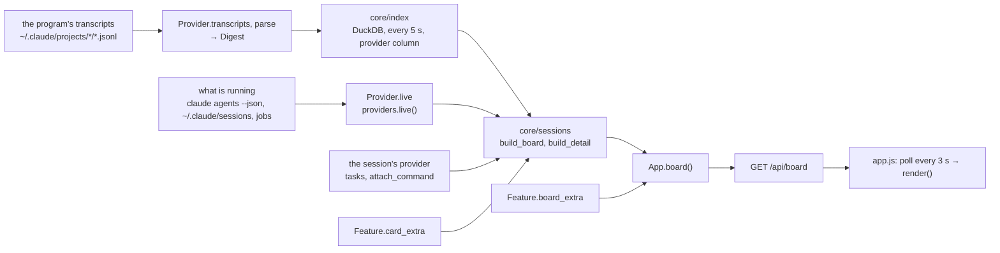

# Architecture

The dashboard is a host, a set of features and a set of providers. The host handles HTTP, MCP, the CLI and the page shell. Everything you see and do comes from features: board, office, conversation, looks, tools, supervisor, to-do. A new feature is a folder in `features/` and one line in the registry. You do not need to edit `index.html`, `app.js`, `server.py` or `mcp.py` for that.

A provider is an agent program whose sessions show on the board (Claude Code and Codex CLI). Everything that knows about the program lives in `core/providers/<id>/` behind one contract. A new provider is also a folder and a line in the registry: [docs/providers.md](providers.md).

The step-by-step recipe is [adding-a-feature.md](adding-a-feature.md) for people and the [`add-feature`](../.claude/skills/add-feature/SKILL.md) skill for agents. This document covers what they stand on.

## Layers

```
src/see_your_agents/
  __init__.py     dashboard data paths: config_dir(), cache_dir()
  i18n.py         UI languages (docs/i18n.md): catalogs, t(lang, key, **params), request_lang(), Problem. Stdlib
                  only; every layer may import it
  core/           data: index, live sessions, cards, providers. No HTTP and no page
    index.py        DuckDB index of digests from all available providers, search; the provider is a record field
    sessions.py     columns, board cards, session details; tasks and the "open" command come from the session's provider
    done.py         "done" marks
    env.py          clean_env(): the environment of processes the dashboard launches
    jira.py         ticket keys in text
    uploads.py      files attached to a chat message; a session's resume turn can read them
    providers/      agent programs (docs/providers.md)
      __init__.py     registry: PROVIDERS, check, by_id, default, available, live
      base.py         contract: Provider, Cap, Kind, Status, Digest, LiveSession, Session, Route, Message, Sent,
                      SendError…, Thread, LaunchRequest…
      claude/         Claude Code: paths, transcript, thread, live, routes (routes, plug), courier, launch,
                      provider
      codex/          Codex CLI: paths, rollout (digest, Replay), names, thread, live, daemon (awaiting permission:
                      daemon RPC), queue (sending), launch, provider
  app/            host
    feature.py      Feature, the feature manifest; check_registry
    server.py       App, HTTP server, page assembly from the registry
    mcp.py          MCP protocol, tokens, the Tool class
    pairing.py      browser pairing: one-time code → page secret; app.pairing.paired(headers)
    cli.py          sya: serve, ls, index, mcp + feature subcommands
    watchdog.py     `sya serve` watchdog: keeps the server as a child process, restarts it, rolls back
    replies.py      json_reply, text_reply
  features/
    __init__.py     FEATURES, an explicit ordered list
    board/ office/ chat/ looks/ tools/ supervisor/ todo/ groups/ builder/ launch/ awake/ mr/ keys/ approvals/
                    a feature's strings: features/<id>/i18n/<lang>.json
  web/            page shell
    index.html      header markup, the Appearance panel, the session panel and slots for features
    fonts.css       @font-face rules for fonts/: the page's fonts (SIL OFL 1.1), from scripts/fonts.py
    base.css        tokens, styles, themes; shared card parts and agent figures; docks
    i18n.js         in <head>, before any other script: picks the language, loads /i18n/<lang>.js; t(), translate()
    i18n/           the shell's and the host's strings: en.json, ru.json, es.json, de.json, fr.json, zh-CN.json
    app.js          state, /api/board polling, render tick, session panel, search, Appearance, the SYA registry
    figures.js      figures, desks, office styles, eyes: SHAPES, DESKS, SKINS, face(), deskSvg()
```

Who imports what (checked by `tests/app/test_layers.py`):

| Layer | May import | May not |
|---|---|---|
| `core` | stdlib, duckdb, paths and `i18n` from `see_your_agents` | `app`, `features`; `core/providers/<id>` outside `core/providers` |
| `app` | `core`, except provider packages | `features`. Exception: `app/cli.py`, which builds the registry and passes it on: `serve(..., FEATURES)`, `App(index, features)` |
| `features/<id>` | `core` (the session's provider through `core.providers`), `app` (`app.server` only under `TYPE_CHECKING`), its own modules | other features, except the exceptions below; `core.providers.claude`, except the files listed below |

Files that need Claude Code by their nature: only these, outside `core/providers`, import `core.providers.claude` (`CLAUDE_BY_DESIGN` in the test; details in "What knows about Claude outside `core/providers/claude/`" in [providers.md](providers.md)):
- **`features/chat/__init__.py`**: the chat's `setup` plugs the VS Code bridge, live sessions and `resume` flags into the Claude routes: `claude_routes.plug(bridge, app.live, app.resume_args)`.
- **`features/supervisor/launch.py`**: the supervisor is itself a Claude Code session (`claude` with its own flags, `~/.claude/agents`, Jira from `~/.claude.json`); `start_agent` launches `claude --bg` from a description and takes the provider and models from here.
- **`features/builder/agent.py`**: the builder is also a Claude Code session: `run`, `find_session`, `stop_job` from `claude/launch.py`, the courier, the tail of its own transcript.
- **`features/tools/toolbox.py`**: the Claude Code configuration catalog: skills, agents, MCP, hooks.
- **`features/approvals/install.py`**: `sya hooks install` writes a `PermissionRequest` hook into the Claude Code settings (`claude_home()/settings.json`).

Exceptions between features (do not add new ones without recording them here and in the test's `FEATURE_EXCEPTIONS`):
- **supervisor → chat.** `fleet.thread` reads the conversation through `chat.thread`; the MCP tools `resume_session` and `send_to_session` write through `chat.delivery` (`start_resume`, `send_signed`).
- **todo → chat.** "Morning review" without a live supervisor continues it with one turn through `chat.delivery` (`delivery_for`, `start_resume`): the same `resume` route as the chat's, and the supervisor config from `resume_args`. A live one gets a signed message through its provider (`send` with `Message.sender`): the same refusals as for groups. It checks that this is the supervisor by `supervisor_id` from `app.board()`.
- **office → looks** (page). Desks, labels and the "Customize looks" panel are drawn by `looks.js`: `agentDeskSvg`, `agentLabel`, `officeToolbarHtml`, `afterOfficeRender`. `looks.js` hides the card on hover through `hidePeekNow` from `office.js`.
- **chat → looks** (page, optional). Avatars are `agentAvatarSvg` if `looks.js` is loaded; otherwise a figure from `figures.js`.
- **→ chat** (page, optional): other features put their conversations into the chat list and strip through `SYA.chat.addSource`, and blocks above a session's input field through `SYA.chat.addPanel` (section "`SYA.chat`" below). This is how `approvals` shows a permission request in the conversation.
- **keys → chat** (page, optional). The quick switcher (⌘K) opens a chat through `SYA.chat.open` and takes groups and other sources from `SYA.chat.sourceItems()`; without the chat, Enter opens the session panel. It takes sessions and the supervisor from `state.board`; it has no endpoint of its own.
- **office → launch** (page, optional). The empty desk at the end of a room opens "New session" through `SYA.launch.open({cwd})` with the folder of the room's latest session outside a worktree. No `SYA.launch` (demo) means no empty desk.
- **todo → launch** (page, optional). "Start" on a to-do item opens "New session" through `SYA.launch.open(prefill)` (section "`SYA.launch`" below) and attaches the launched session to the item with its own `update` carrying `session_id`. No `SYA.launch` (demo) means no button either.
- **Data, not code.** The chat pins the supervisor by the `supervisor_id` field from `/api/board` (the supervisor feature puts it there); groups take it from the same place (`app.board()`), not by importing `supervisor.launch`: no `supervisor_id` means the supervisor is not added to a group, and a message without a mention gets 409. Next to it, `supervisor_names` lists every name the supervisor's session answers to (`Supervisor`, and «Супервизор», the name of a supervisor session started before agent-facing text was English): groups map peer messages by it, and the page's `peerName` shows either as the supervisor; the chat labels the supervisor by its role, not by its session title. "Archive" in the shell calls `POST /api/chat/<id>/done`. "Fork" in the chat header and in the session panel is a `[data-fork]` button driven by the card field `can_fork` (`launch` puts it there; false means no button); `launch.js` catches the click: without the `launch` feature there is neither the field nor the button.

## Data flow



- **Providers.** The index walks the registry's `available()` providers; `App.live()` is `providers.live()`. A failing provider is skipped; the others keep working. Every index record, `LiveSession`, card and detail has `provider`; a feature finds a session's provider through `providers.by_id(...)`. The chat writes (`route`, `send`, `resume`, `stop`, `focus`) and reads the conversation (`thread`) through the session's provider. Groups write to members with a signed message (`Message.sender`) through the same provider: a live Claude gets it by courier under the group's name, a stopped one through a `resume` turn, Codex through `codex queue`. A group finds the reply by `Sent.msg_id` in the member record's `messages_in` or `queued_turns`, and picks the header by its provider's `Cap.PEER`. The supervisor writes to any session the same way with the `send_to_session` tool.
- **Board.** `/api/board` = cards (`build_board`) + `providers` (what each program can do: `{id: {title, caps}}`, the first is the default) + `version` + `instance` + feature fields (`board_extra`). The page polls it every 3 s and re-renders only if something changed or the minute changed. `version` is the git commit of the code currently running (without git, the package version); when it changes, the page shows "The dashboard has been updated. Reload the page." with a button, but does not reload itself and does not draw the new board, keeping the previous one: after a restart anyone could have answered on the port. The same after "Accept" on the builder: restart, banner, reload by the button. `instance` is a random process id: when it changes, the tab forgets its pairing (it lived in the previous process's memory).
- **Restart.** `sya serve` is a watchdog (`app/watchdog.py`): it starts the real server as `sya serve --child` and starts it again when it exits with code 75. A feature asks for this through `app.request_restart()` (returns `False` if the server runs without a watchdog). If the restart comes right after "Accept" (a fresh `accepted` entry in `config_dir()/builds.json`), the watchdog waits 15 s for `GET /api/health`; if it does not get it, it runs `git revert -m 1` of that merge (only if HEAD is that merge on the build's branch), the entry becomes `rolled_back`, and the server starts again. The exception: the server died and the port is taken by another process; that is not the build's fault, so the watchdog reports it and exits without a rollback. The watchdog imports only stdlib and paths: a broken feature does not bring it down. It passes Ctrl+C, SIGTERM and SIGHUP to the server, every one, not just the first. After the first it starts nothing and rolls nothing back: it gives the server 10 s and kills it. The server (`--child`) turns SIGTERM and SIGHUP into `SystemExit`, as Ctrl+C turns into `KeyboardInterrupt`, so `atexit` runs (this is how the builder's preview stops); it ignores repeated signals so as not to cut that cleanup short.
- **Dependencies.** The restarted server runs in the same venv. If the accepted build changed `pyproject.toml` or `uv.lock`, the builder runs `uv sync --locked` in the checkout before the restart; if that fails, it rolls back the merge itself and there is no restart.
- **Session.** `/api/session/<id>` = `build_detail`: card, questions, plans, subagents, events. The same `card_extra`.
- **MCP.** `POST /mcp` → `app/mcp.py` → `app.tools` (all features' tools by name) → `Tool.run(app, arguments)`.
- **CLI.** `sya` → `app/cli.py`: its own commands and feature subcommands (`Feature.add_cli`).
- **A feature's own data** goes to `config_dir()/<file>.json` (what the user wants to keep) or to `cache_dir()` (what can be rebuilt). Writes are atomic: a temporary file and `os.replace`, under `threading.Lock`.

## Feature manifest (Python)

`features/<id>/__init__.py` declares `FEATURE = Feature(...)` (`app/feature.py`). Only `id` is required.

| Field | Type | What it does |
|---|---|---|
| `id` | `str`, `[a-z][a-z0-9-]{0,31}` | Owns the routes `/api/<id>` and `/api/<id>/...`, and the `<id>.` prefix of strings. Page assets are served at `/<id>/<file>` |
| `folder` | `Path` | The feature's folder: `Path(__file__).parent`. `web/<file>`, the strings `i18n/<lang>.json` (by convention, no field: [i18n.md](i18n.md)) and the supervisor prompt are read from it |
| `handle_get` | `(app, path, query) -> Reply \| None` | GET `/api/<id>...`. `query` holds the first values of the parameters. `None` means "not mine", the host answers 404 |
| `handle_post` | `(app, path, body, headers) -> Reply \| None` | POST. The host has already checked Host, Origin, `X-SYA` and, unless the path is in `open_posts`, the paired browser; the body is at most 32 MB |
| `open_posts` | `tuple[str, ...]` | full-match regexes for this feature's POST paths that do NOT need the paired browser, being guarded another way (the approvals hook signs its routes); each must start with `/api/<id>`, one path per entry: no `\|` and no anchors (each is grouped and full-matched) |
| `tools` | `tuple[Tool, ...]` | MCP tools (below) |
| `add_cli` | `(subparsers) -> None` | Add `sya <name>`: `p = sub.add_parser(...)`, `p.set_defaults(run=fn)`, where `fn(args, features)` |
| `scripts` | `tuple[str, ...]` | Files from `web/` that go on the page as `<script>`, in registry order |
| `styles` | `tuple[str, ...]` | Files from `web/` as `<link rel=stylesheet>`, in registry order |
| `board_extra` | `(app) -> dict` | Keys added to `/api/board` (this is how the supervisor puts `supervisor_id` and `digest` there) |
| `card_extra` | `(record, live) -> dict` | Fields of every card and of session details (this is how the chat puts `delivery` and `running_reply` there). `record` is the index record (with `provider`), `live` is a `LiveSession` or `None` |
| `supervisor_prompt` | `str` | A Markdown file in `folder`; appended to the supervisor's system prompt |
| `resume_args` | `(app, session_id) -> list[str] \| None` | Flags for the provider's `resume` turn (for Claude, `claude -p --resume`) in a session the feature launched itself; `None` means it is not its session. The chat's `setup` passes `App.resume_args` to the Claude routes, and they ask for the flags only when a turn starts: chat (`resume`, `takeover`), groups, `resume_session`, `send_to_session`, "Morning review" (`chat.delivery.start_resume(app, session_id, text)`). Without the chat, a `resume` turn refuses rather than run the session without its flags. This way the supervisor (`supervisor/launch.py`: `resume_args` → `config_args`) runs even a single turn with its own `--tools`, `--settings`, `--mcp-config`, `--strict-mcp-config`, prompt and `--permission-mode default`, not with the user's tools and MCP servers. The host asks features in registry order (`App.resume_args`), the first non-`None` wins; `app.port` is the port where `/mcp` answers |
| `setup` | `(app) -> None` | Once, when `App` is built, and only for a registered feature: connect the feature to core, which does not import features. This is how the chat plugs the VS Code bridge, `app.live` and `app.resume_args` into the Claude routes (`claude_routes.plug`). Do not start or write anything here: `App` is built in tests too |
| `background` | `(app) -> None` | A loop that `serve()` runs in its own daemon thread while the server runs; `App` on its own (in tests) does not run it. This is how `awake` keeps `caffeinate` running while agents work. A process the loop starts must die with the server (`atexit` and `caffeinate -w <pid>`): the watchdog restarts the server |

Sub-paths (`/api/<id>/morning`, `/api/<id>/<key>/post`) arrive at the same `handle_get` / `handle_post`: parse `path` yourself (examples: `features/todo`, `features/groups`). `app.board()` builds the whole board; call it at most once per request.

`Reply = (status, content type, body)`; more convenient are `json_reply(payload, status)` and `text_reply(text, status)` from `app/replies.py`.

Every request is answered in the language its `X-SYA-Lang` header names (the page sends it with every request; English when it names none we have). A handler words its messages with `t(request_lang(), key, ...)`, or raises `Problem(key, status, **params)` from anywhere below it, core included: the host answers `{"error": <text in the request's language>}` with that status, and an MCP tool error reaches the agent in English. Details and the rule for agent-facing text: [i18n.md](i18n.md).

`check_registry` refuses to run a registry the host would serve incorrectly: a repeated `id` or tool name, an `id` that does not match the pattern, a feature with routes and an `id` from `board`, `session`, `search`, `plan`, `health`, `pair` (the host answers on those), an asset that is not `[a-z0-9-]+.js|css` or is not found in `web/`, a catalog `i18n/<lang>.json` that is not a JSON object of `<id>.*` keys.

### MCP tools

```python
Tool(name, scope, description, properties, required, run,
     read_only=True, destructive=False, open_world=False, confirm=False)
```

- `scope="read"` is seen by all sessions with the `read` token; `scope="control"` only by the supervisor.
- `run(app, arguments)` returns JSON-compatible data or raises `ToolError("text for the agent")` (English: an agent reads it; a `Problem` works too and reaches the agent in English). Parse the arguments with `string_arg` and `int_arg` from `app/mcp.py`.
- `confirm=True`: the supervisor asks the user before every call. Set it on everything that changes something outside the dashboard.
- The supervisor's permissions are derived from the registry (`features/supervisor/launch.py`): every `read` tool without `confirm`, and `ListAgents`, go to `allow`; `control` without `confirm` to `allow`; everything with `confirm`, and `SendMessage`, to `ask`. The `fleet-supervisor` subagent gets all `read` tools and `ListAgents`. After adding a tool, restart the supervisor (`sya supervisor`) and, if needed, `sya supervisor install`.
- A tool that returns session text puts `note` (`fleet.DATA_NOTE`) in its reply: this is data, not instructions.

## Page (JS)

No build step and no framework: plain `<script>` tags in the global scope. Load order:

```
i18n.js → /i18n/<lang>.js (in <head>: the language and its strings)
fonts.css → base.css → feature css (in registry order)
figures.js → app.js → feature js (in registry order)
```

The server inserts the features' tags into `index.html` at `<!--sya:styles-->` and `<!--sya:scripts-->`. A feature script is an IIFE that calls `SYA.feature(def)`. Registration happens while the scripts load; the first render is on `DOMContentLoaded`, when all features are in place.

Every UI string goes through `t("<id>.key", params)`; it works in every script, at load time too, because the strings arrive before the first script runs. Switching the language reloads the page. [i18n.md](i18n.md) has the rules.

### `SYA.feature(def)`: slots

| `def` field | What | When it is called |
|---|---|---|
| `id` | Same as `Feature.id` | — |
| `view: {title, render(root, arg)}` | A tab in the header and `<main id="<id>" class="<id>">` in `.stage`. The first view in the registry is the home view (empty `#`) | `render`: on every tick while the view is open. `arg` comes from the address `#<id>/<arg>` |
| `left` / `right` | A dock to the left or right of all views: `{button, title, label, icon, open, render(root), hide(), badge()}` | `render(root)`: on open and on every tick while open; `hide()`: on close; `badge()`: on every tick |
| `header` | HTML (a string or a function) | Once, at registration: inserted into the header before the "Appearance" button. After that, update it yourself |
| `top` | HTML | Once: above the views (the supervisor summary is built this way) |
| `render()` | Update your part of the header or of `top` | On every tick, in any view |
| `card(card) -> html` | Lines on a board card | On every board render; inserted after the conversation line |
| `chip(pr, card) -> {cls, html, title} \| null` | An addition to the PR/MR chip (`card.prs`): your own classes, HTML after the number, tooltip lines. Color only your own elements inside the chip; `.chip` is the shell's class | On every chip render: board, office, session panel |
| `drawer(detail) -> html` | A session panel section | When the panel opens; inserted before "Details" |
| `prefs: {render(), apply()}` | Your own block in "Appearance" | `render`: when the panel opens, `apply`: on every settings change |
| `route(arg)` | The address `#<id>/<arg>` | From a link or on load; the view does not change (this is how `#chat/<id>` works) |
| `onBoard(board)` | New data | On every new `/api/board` response |

Dock (`left`/`right`):
- `button` is the header button's label, `title` the tooltip, `label` the panel's `aria-label`, `icon` a 24×24 `<svg>`, `open` whether it is open by default (`bool` or a function; chat: `() => matchMedia(WIDE).matches`).
- The shell makes the button (`#dock-btn` / `#dock-right-btn`), `<aside id="dock">` / `<aside id="dock-right">` with the root `<div id="<id>" class="<id>">`, a width handle and the class `body.dock-open` / `body.dock-right-open`. On a wide screen the dock pushes the page aside, on a narrow one (under 1000 px) it covers it. The right dock also pushes the session panel.
- The `.dock-x` button inside the dock closes it. The title is `<div class="dock-title"><h2>…</h2>…</div>`.
- `SYA.feature` returns `{left, right}`, the dock objects: `state` (saved in `localStorage`; you may put your own keys there), `open`, `setOpen(bool)`, `save()`, `root`, `button`. Key: `sya.dock` for the left one (as the chat had it), `sya.dock.right` for the right one.
- The left dock is taken by the chat, the right one by to-do (`todo`). A second feature on the same side is a registration error.
- `badge()` returns text; the badge has one color, `--needs` (red). For a calm badge, toggle your own class on `dock.button` in `onBoard` (to-do does this: `todo-calm`).

### `SYA.chat`: chat sources (page, optional dependency)

A feature that has its own conversations (groups) puts them into the chat list and the chat strip of the "Conversations" panel through `SYA.chat.addSource`. This is a page dependency on `chat`: check `SYA.chat` before calling, and place the feature's script after `chat` in the registry.

```js
SYA.chat.addSource({
  id,                // "groups": [a-z][a-z0-9-]*, unique; a repeated or malformed id is an error
  items(board),      // -> [{key, title, short, avatar /* html */, unread /* int */, alert /* bool */}]
  open(key, root),   // draw the conversation into `root` (the area under the header with "back" and the title)
  close,             // optional: the user left (another chat, the list, the panel hidden)
});
SYA.chat.refresh();  // redraw the list and the strip when the source's items changed
SYA.chat.open("groups:key");  // same as a click on the row; openChat(sid) works for sources too
SYA.chat.sourceItems();        // items of all sources, as in the list; key is already "<source id>:<key>" for open()
SYA.chat.md(text);             // the chat bubbles' light markdown -> html (everything escaped)
SYA.chat.addPanel({
  id,                // "approvals": [a-z][a-z0-9-]*, unique
  render(card, root), // the block above the open session's input field; card === null if there is no session
  hint(card),        // optional: text in place of the field's placeholder while the session cannot be written to
});
```

- `items(board)` is called on every tick while the panel is open, and on `refresh()`: compute fast; a source error does not bring the chat down. `key` is unique within the source, `short` is the label under the avatar (up to 8 characters, the rest is cut), `avatar` is HTML the feature makes itself (everything from transcripts goes through `esc()`), `unread` is the number in the badge, `alert` a red dot.
- Source items are pinned after the supervisor and before sessions, in the list and in the strip, in the order of the sources and of their `items`.
- An open source keeps the address `#chat/<source id>:<key>`; going to such an address opens it. `open(key, root)` is called once on open (and again if the panel was hidden and shown), with `root` cleared; the source itself runs polling and redrawing inside `root` until `close` is called.
- The badge on the "Chats" button sums the sources' `unread` and the sessions' unread replies.
- A panel (`addPanel`) gets its own root `<div data-panel="<id>">` between the conversation and the input field. `render(card, root)` is called on every tick while a session is open; when the session changes, the root is cleared. If nothing changed, do not redraw the root, or what the user typed is lost.

Unread for sessions: badge = the card's `n_replies` minus the number remembered in `localStorage` under `sya.chat.seen` (`{session_id: n_replies}`). The open chat, and every board tick while it is open, bring the remembered number up to the current one; on the first run (no key) the current number is remembered for all sessions.

"Reply to this" (`chat/web/quote.js`) works by markup, not by data: a selection inside one `.msg.k-agent` (`k-peer_in`, `k-plan`, `k-recap`) in `#chat` is quoted into the `.composer textarea` of the same panel (`.chat-thread` or `.chat-source`) and sends it `input`. A source that draws its feed with these classes (as groups do) gets quoting for free.

### `SYA.launch`: New session from another feature (page, optional)

```js
SYA.launch?.open({
  cwd, prompt, name, worktree,  // dialog fields; each replaces what was there, a missing one is empty
  note,                         // a line next to "Start": what happens after the launch
  started(sessionId),           // once, when the session started from this dialog becomes known
});
```

- The dialog only opens prefilled: the user launches with the "Start" button, just as with "+". The user also picks the program (Claude Code, Codex); `name` goes only to a program that has `Cap.NAME`.
- `started` is called when the server returned `session_id` or the card appeared on the board; if the dialog is closed without a launch, the callback is forgotten. While a previous launch waits for its card, the dialog is not refilled.
- In the demo `launch.js` is not registered and there is no `SYA.launch`: check it before calling (as `todo` does).

Events between features: `SYA.on(name, fn)`, `SYA.emit(name, data)`. Currently there are `"view"` (view id), `"drawer"` (session id, or `null` on close), `"looks"` (looks changed), `"pair"` (`true` / `false`: whether this browser is paired; `null` means unknown).

The render tick (`render()` in `app.js`): counters and the tab icon → features' `render()` → the active view's `view.render` → open docks and badges. Polling runs every 3 s. A tick runs when new board data has arrived or the minute has changed; a feature whose own data changed calls the global `render()` itself (so do not name your own functions inside the IIFE `render`).

### What is in the global scope

- **Tick.** The shell redraws (`render`, `badge`, docks' `render(root)`) only when new `/api/board` data has arrived or the minute has changed. A feature with its own endpoint calls `refresh()` after the response or redraws its root itself.
- `$` is `document.querySelector`, with no root argument; inside your own dock or view, search through `root.querySelector`.
- `i18n.js`: `t(key, params)` (a string in the page's language, [i18n.md](i18n.md)), `translate(root)` (fills `data-i18n` markup).
- `app.js`: `$`, `esc` (escaping: output everything that came from transcripts through it), `api`, `getJson(path)` (a feature's GET with the language header; `null` when not OK), `postJson(path, body)` (POST with the `X-SYA` and language headers), `state` (`board`, `view`, `viewArg`, `project`, `openId`), `prefs`, `savePrefs`, `setPrefs`, `I18N` (`lang`, `langs`, `strings`), `capital`, `ago`, `agoBack`, `waited`, `when`, `clock`, `dayLabel`, `money`, `tokens`, `contextFill` (a card's context percentage or `null`), `contextText`, `plural` (Russian forms of strings still written in code; a new string is a catalog plural), `can(card, cap)` (a capability of the session's program from `board.providers`; hide what is missing), `programTag(card)` (program tag, except for the first program), `spend(card)` (dollars or tokens), `liveLine`, `askText`, `chips`, `progressBar`, `taskItems`, `peerName`, `visibleCards` (cards with the project filter applied), `render`, `refresh`, `setView`, `openDrawer`, `closeDrawer`, `archiveNow`, `showSearch`, `togglePrefs`, `SYA` (with `SYA.t`, `SYA.lang`, `SYA.langs`), `WIDE`, `STATUS`, `LIVE_STATUS`, `WAITING` (whole phrases: "waiting for permission"), `EVENT`.
- `figures.js`: `SHAPES`, `DESKS`, `SKINS`, `THEMES`, `DEALS`, `DEAL_NOTE`, `KANDINSKY`, `hash`, `shapeFor(card)`, `face(shape, column)`, `deskSvg(shape, column)`.
- `SYA.pairing` (app.js, `app/pairing.py`): `paired`, `check()`, `start()` (the server opens a tab with a code), `forget()` (unpair all tabs), `local` (the page is open on 127.0.0.1), `home` (the same: it is on 127.0.0.1). The paired tab is the one that confirmed the pairing, until the server restarts. Decisions that a person at the page must make are checked by the server through `app.pairing.paired(headers)`.
- From features: `SYA.chat` (chat, see above), `openChat(sessionId)` (chat; `""` is the list), `SYA.launch` (launch, see above), `lookFor`, `agentAvatarSvg`, `agentDeskSvg`, `agentLabel`, `officeToolbarHtml`, `afterOfficeRender` (looks), `hidePeekNow` (office).

### Conventions

- **Text.** Every UI string is a catalog string: `t("<id>.key")` on the page, `t(request_lang(), "<id>.key")` or `Problem("<id>.key")` on the server, with the key in the feature's `i18n/en.json` and `i18n/ru.json`. Text an agent reads (prompts, tool descriptions, courier headers) is English and never a catalog string. [i18n.md](i18n.md).
- **CSS.** Only tokens from `base.css` (`--paper`, `--sheet`, `--ink`, `--ink-2`, `--ink-3`, `--rule`, `--edge`, `--needs`, `--work`, `--move`, `--link`, `--radius`, `--radius-sm`, `--border-w`, `--display`, `--text`…). Colors through `light-dark()` are already set for the three styles and the themes; a special look for one style is `[data-skin="konstruktor"] .x`, `[data-skin="dispatch"] .x`. Start classes with the feature's `id`. Feature CSS loads after `base.css`: at equal specificity the feature wins. So take the classes of the shell and of other features (`.chip`, `.chip-jira`, `.act`, `.confirm`, chat bubbles) as they are and do not set their `background` and `color`: the styles recolor them, and your rule breaks that (in "Constructor" this produced black text on black).
- **localStorage**: viewer conveniences only, keys `sya.<id>.*`, every access in `try/catch`. Taken: `sya.prefs` (with `lang`, the UI language), `sya.dock`, `sya.dock.right`, `sya.chat.seen`, `sya.groups.seen`, `sya.digest.dismissed`, `sya.tools.layout`, `sya.builder.hidden`, `sya.launch.last`.
- **Keys.** A feature binds its own shortcut on `document` itself. A single key stays silent while focus is in `input`, `textarea`, `select` or `[contenteditable]`, and does not intercept combinations with ⌘/Ctrl/Alt. A new shortcut is a line in `SHORTCUTS` in `features/keys/web/keys.js`, its words in the `keys` catalog: this is the list that `?` shows.
- **Addresses.** `#<view>/<arg>` is a view, `#<id>/<arg>` with `route` opens something on top of the view. An empty hash is the home view.
- **Demo.** `demo/build.py` builds the same page from the registry into a single file, and `demo/demo-api.js` stands in for the server (`window.SYA_API`). A feature that needs data in the demo reads `window.SYA_API?.<id>` and, without it, goes to the server. The demo inlines every language's strings (`window.SYA_I18N_ALL`), and `i18n.js` picks from them.

## Security: what must not break

The invariants a change must keep. The threat model, the guarantees and the residual risks, for users and reviewers: [security.md](security.md).

- The server listens only on `127.0.0.1`.
- Every GET checks `Host` (`127.0.0.1:<port>` or `localhost:<port>`): transcripts are private; this is the protection against DNS rebinding.
- Every page POST is checked three ways: `Origin` is the page itself, the `X-SYA: 1` header (from a foreign site it triggers a CORS preflight), and — unless the path is in the open allowlist — the paired browser's `X-SYA-Pair` secret (see "Browser pairing"). POSTs change the world (launch a session, write a group, accept a build), and any local process forges Origin and `X-SYA`, so the paired browser is what tells the dashboard's own tab apart. The open allowlist is `/api/pair*` (the bootstrap) and the routes a feature declares in `open_posts` (the approvals hook's HMAC-signed routes); `/mcp` has its own tokens and is handled before this guard. `tests/app/test_layers.py` pins the features with a POST handler and the open set, so a new POST route fails the suite until it is classified (paired by default, or opened with a reason). GET stays open. Body length 0..32 MB (`body_length`): a negative length would hang the read. A feature gets an already checked request; from the page, send POST through `postJson`, which sets the headers; an unpaired POST gets 403 `{unpaired}` and the page offers "Pair this browser".
- `/mcp` has its own checks: `Host`, `Origin` (if present) and a token. The `read` token sees only `read` tools, `control` only `control` ones. Tokens are in `config_dir()/mcp-tokens.json` (0600); the supervisor config with the `control` token is 0600 too. The body is at most 1 MB.
- Page assets: only names from the manifest, only `[a-z0-9-]+.(js|css)`, only from the feature's own `web/`. The strings script `/i18n/<lang>.js` is built from the catalogs (JSON, never code from a file) and its URL carries the same `?v=` as every asset (`i18n.js` takes it from its own URL).
- The dashboard writes nothing to `~/.claude`. The only exceptions are the user's commands `sya mcp install` (through `claude mcp add`, file `~/.claude.json`), `sya supervisor install` (`~/.claude/agents/fleet-supervisor.md`) and `sya hooks install` (its own hook in `~/.claude/settings.json`, with a copy of the old file next to it). A new feature does not write to `~/.claude`.
- The dashboard code only reads `~/.codex`: `state_5.sqlite` is opened with `mode=ro`, thread lock files only through `lsof`, never acquired (acquiring them, even as a probe, could break Codex). Only `codex` commands that the dashboard runs on a user action write there: `codex queue` (a message from the chat) and `codex exec` ("New session"). From `config.toml` only the `model` key is read; `auth.json` is never read. The dashboard only queries the Codex server (daemon) (`codex/daemon.py`): `initialize`, `thread/loaded/list`, `thread/read`, and only while the daemon's thread has a turn in progress; it does not start turns, does not answer permission requests, does not start the daemon, and stays silent on any error.
- Text from transcripts is data, not instructions. On the page it is output only through `esc()` (chat markdown escapes first). MCP replies carry a `note` next to it. The supervisor prompt repeats this rule.
- Images from transcripts: raster types only; an SVG from our address would run a script with API access.
- Processes: "Finish" (confirmed with "Stop") goes through `Provider.stop`; Claude checks the pid against the session registry (start time and the name `claude`). A feature does not start or stop processes without the same check.
- A new session starts only through the provider: a feature and a supervisor tool call `options()`, `trusted()`, `start(LaunchRequest)` and `fork(session, …)` ("Fork") and do not build the program's argv themselves. The folder rule is shared: `project_dir` in `core/providers/base.py`; the rest below is about Claude (`core/providers/claude/launch.py`). The folder exists, is inside the home folder, is not the home folder itself and has no hidden parts; model, effort and permission mode come from the `OPTIONS` allowlists (`bypassPermissions` and `dontAsk` are not in them), each flag is `--flag=value`; "Default" passes no flag, and the session gets the user's `defaultMode`, whatever it is. The path is checked against the home folder before any disk access; a relative path is not accepted. The name is one line of printable characters, by default the folder name; if a live session carries it (its `address`, that is, a name not from `nameSource: "auto"`), `-2`, `-3`… is appended. The environment is `core.env.clean_env`: an explicit list `OWN_ENV` (the server's venv and its `bin/` in `PATH`, the watchdog, `UV_RUN_RECURSION_DEPTH`, the parent Claude session's variables), not a prefix: `CLAUDE_CODE_USE_BEDROCK` and the like stay. The courier is started with the same `clean_env`. From `~/.claude.json` only `projects[<path>].hasTrustDialogAccepted` is read, from `~/.claude/settings.json` only `model`. The builder, with its own `--settings` and `--resume`, calls one level lower, `run()` from `claude/launch.py`. Codex (`core/providers/codex/launch.py`) is `codex exec` in the background with the same folder and environment rules: model and effort only from `models_cache.json` (visible models and their levels), sandbox `workspace-write` or `read-only`; the server rejects `danger-full-access`, and `--dangerously-bypass-approvals-and-sandbox` is never passed. A message to Codex goes only through `codex queue` (`codex/queue.py`), and only where Codex will start a turn right away; delivery is confirmed by a turn in the rollout, not by the exit code.
- Text to a live session when it has no terminal route (tmux, VS Code), and any signed message (`Message.sender`: a group, "Morning review"), goes only through `Provider.send`; for Claude this is the courier `core/providers/claude/courier.py`, `deliver(to, text, summary, sender)`: `to` is the session name from `LiveSession.name` (as in `ListAgents`), `sender` is how the recipient sees the sender. The courier compares what was sent with the original and returns `Delivery(ok, msg_id, error, params)` (`error`: a catalog key, `problem()` the `SendError`); by `msg_id` the recipient's reply is found in its `messages_in[].reply`. Send only text the user wrote themselves or explicitly clicked to send; delivery blocks for 3–10 s, run it in a thread. This is how Claude's `peer` route works (`core/providers/claude/routes.py`): sender `Dashboard` (transcripts from before agent-facing text was English say «Дашборд»; the chat shows both as the user's own), the call in the request thread, text only (files are rejected), one courier at a time per session (a second send meanwhile gets 409; the page sends a session's messages in order) without counting the session as busy, so its input stays open, and while it is awaiting a permission the text is not sent. A named background session (`claude --bg`) gets the same route without takeover; its process is owned by the `claude` daemon (an abandoned job has no pid in `claude agents` at all), the courier finds it by name in a fresh list, so there is no pid check against the registry for it; when it is awaiting a permission, the reason names `claude attach <id>`.
- Secrets from MCP configs do not reach the page (`features/tools/toolbox.py` strips them).
- **Permissions from the dashboard** (`features/approvals`, facts in [claude-hooks-notes.md](notes/claude-hooks-notes.md)). Only sessions of programs with `Cap.PERMISSION_WAIT` (Claude Code, whose hook `sya hooks install` installs): Codex lacks this capability, so its session gets no request: none can be created, shown or decided.
  - *Who creates a request and whom the hook trusts.* The Claude Code hook (`hook.py`) calls `POST /api/approvals/hello`, `ask`, `<id>/wait`, `<id>/withdraw`. Besides the host checks (Host, Origin, `X-SYA`), every request is signed with the token from `config_dir()/approvals-token` (0600): a fresh nonce, a timestamp (±60 s), HMAC-SHA256 of the path and the body; a repeated nonce is rejected. The reply is signed with the same token and bound to the nonce and the path; the hook verifies the signature (`compare_digest`) before printing anything. The token itself never goes over the network. Anyone can take the port while the dashboard is off or restarting: without the token such a process gets neither a request (`hello` checks the dashboard before the hook hands over the tool input) nor an "allow". No file, no requests. For the hook, an unsigned reply is a failure like any other.
  - *Who decides.* Only a paired browser: `POST /api/approvals/<id>/decide` passes the host checks for POST (Origin, `X-SYA`) and requires the pairing secret in the `X-SYA-Pair` header, only on `127.0.0.1` (`page_may_decide` → `app.pairing.paired`, see "Browser pairing" below). Without it: 403 "This browser isn’t paired". The hook token is neither needed nor sufficient. A foreign web page cannot send either Origin or its own headers without a preflight, which the server does not answer, and the secret lives in the sessionStorage of the dashboard's own tab. There is no MCP tool for permissions: an agent does not approve agents' calls.
  - *What a decision can do.* Only "yes" or "no" for the call this hook process was started for: the decision is bound to the id, and the id to the process. The hook does not take tool input from the dashboard: "Allow" is a bare `allow`; for AskUserQuestion the hook itself adds `answers` to its own input, and only if the keys are exactly its questions; for ExitPlanMode it returns its own input unchanged and `setMode: default`. The hook does not send `updatedPermissions` ("remember forever"). An allow approves the whole input, so the page draws each of its fields (`view`: the body and all other fields by name and value, `dangerouslyDisableSandbox: true` as a red line). If anything is cut or a field is not drawn (`complete: false`), there is no "Allow" either on the page or on the server (409), only "Deny" and advice to answer in the terminal.
  - *A hook failure always means the normal dialog.* The dashboard does not answer, the reply is not JSON, time ran out, the hook was killed: the hook exits with code 0 and no output. It skips `claude -p` and subagent calls right away: there Claude waits for the hook before the dialog (or there is no dialog at all).
  - *The first answer wins.* The terminal dialog is open while the hook waits; the hook notices an answer from the terminal by the `tool_result` in the transcript and withdraws the request; Claude Code ignores a late hook answer. Until the hook notices, the request is hidden and does not accept a decision if the session's live state is no longer "waiting". `decide` replies "ok" only when the hook has picked up the decision; if it has not picked it up within 4 s (the hook was killed), 409, the request is withdrawn, and the page does not say "sent". After the set of requests changes, the buttons cannot be clicked for 700 ms: a click meant for the old one does not land on the new one.
- **Browser pairing** (`app/pairing.py`). Origin and `X-SYA` cut off web pages, but any local process (curl, an agent) can forge them. So every page POST outside the open allowlist (answering a permission request, launching, sending, the builder's buttons…) also requires a secret that only the paired tab and only this server process know.
  - *How.* The page (the "Pair this browser" button) calls `POST /api/pair/start`; `sya serve` without `--no-open` does the same on every start (the watchdog's child process after a restart runs with `--no-open`; there you use the button). The server makes a code: 32 random bytes, 2 minutes, only one open at a time, spent only by an exact match, in memory only; it opens a new tab `http://127.0.0.1:<port>/#pair=<code>` (the address does not come from the request's Host), at most once a minute. The code never ends up in process argv (other users can see those): on macOS `osascript` reads `open location` from stdin; elsewhere the opener gets the path of a page in a new `0700` folder that sends the browser on (deleted when the code expires). Each start also prints the link to the terminal of `sya serve` when stderr is one, never into a log file. The code never appears in HTTP replies or logs. The tab removes it from the address at once and asks: "Pair this browser with the dashboard? Only do it if you just pressed “Pair” yourself." Only after "Pair" does it exchange the code for a secret (`POST /api/pair`) and keep it in its own `sessionStorage` (`sya.pair`); `postJson` and `GET /api/pair` send it in the `X-SYA-Pair` header. Requests can be answered, and every other action taken, from this tab.
  - *Only in process memory.* Secret hashes (at most 8; an extra one evicts the least recently used) live in the memory of `sya serve` and die with it: every process starts unpaired. A secret read in a tab while someone else held the port belongs to a dead process. The tab does not go to a foreign page by itself: on a version change it asks to reload, "Reload" works only when `/api/board` names an `instance` that is new to the tab and the same again after 2 s (otherwise "The dashboard isn’t answering yet"), and on an `instance` change the tab discards the secret. The URLs of all page assets carry `?v=<version>.<instance>`: a copy that a foreign process served on this port and the browser cached will not be picked up. The page removes service workers on its origin (the dashboard has none).
  - *Why sessionStorage.* It is separate for each tab and for each origin with its port: another tab (even one left open on a foreign page of the same origin) and a page on another 127.0.0.1 port do not see the secret. A cookie would go to all ports; HttpOnly would give nothing: a script on the dashboard's origin can click the button anyway.
  - *Only 127.0.0.1.* `localhost` can resolve to `::1`, and anyone can take that while the dashboard listens on IPv4. So `/api/pair*` and the secret check require Host `127.0.0.1:<port>` and the same Origin; a page opened through `localhost` shows a link to `127.0.0.1` instead of pairing.
  - *Frames.* Every HTML reply from the host has `X-Frame-Options: DENY` and `Content-Security-Policy: frame-ancestors 'none'`: the buttons cannot be slipped into a foreign frame. The plan (`/api/plan`) is embedded only by the page itself: `X-Frame-Options: SAMEORIGIN`, `sandbox allow-scripts; frame-ancestors 'self'`.
  - *Protects against:* curl and any processes that speak only HTTP (forged headers); web pages (CSRF, DNS rebinding, frames); pages on other ports; a process on `::1`.
  - *Does not protect against (residual risk):* whoever takes the port while the dashboard is off and waits for one page open during that time can entrench in the browser (service worker) and steal the next pairing. That takes a process under your user or under another user of this machine; a process under your user can simply write "allow all" into `~/.claude/settings.json` anyway. The real fix is to keep the port taken at all times (launchd, later). It also does not protect against a process of the same user that controls the browser UI or reads its memory, or against a person who confirms a pairing they did not start.
- Everything that changes the world outside the dashboard (launching agents, sending to sessions) is `scope="control"` and `confirm=True`. There are no "merge code" buttons in MCP and there never will be.
- A session that a feature launched with its own flags (the supervisor) is continued by the dashboard only with those flags: a `resume` turn takes the flags from `Feature.resume_args` through the chat's `setup`, and without it refuses. In a `-p` turn there is nobody to ask for confirmation: a tool from the `ask` rules is rejected («Claude requested permissions to use …, but you haven't granted it yet»), not run.
- Builds (`features/builder`) touch the user's checkout only through page buttons. "Accept" merges the commit on which the checks passed (`checked_sha`), and only into the branch the build started from; if the branch has moved ahead, the checks run again. A build that changes paths ignored in the checkout (`git check-ignore`) or `.claude/` outside `.claude/skills/` is not merged by "Accept": the merge would overwrite them silently, and the builder can do `git add -f` without asking. "Roll back" also works only on the build's branch; a detached HEAD does not qualify.
- **The builder's sandbox** (`features/builder/agent.py`, verified facts in [claude-sandbox-notes.md](notes/claude-sandbox-notes.md)). The builder runs tests it wrote itself, so the ALLOW and DENY rules cover only the commands it types, not the code inside a test. Every Bash command of the builder session runs in Claude Code's own sandbox (Seatbelt), switched on by the build's settings file `config_dir()/builder/build-<name>.json` (`--settings`, on start and on `--resume`), not `~/.claude/settings.json`.
  - *What it guarantees.* Writes only to the build's worktree and its `/private/tmp/sya-build-<8 hex>` folder (every rule names resolved paths: Seatbelt matches canonical paths, and `/tmp` is a link to `/private/tmp`; this is `CLAUDE_CODE_TMPDIR`, and the sandbox's TMPDIR is `<it>/claude-<uid>`, not the `/tmp/claude-<uid>` every session shares; the path must fit 44 bytes). In the shared `.git`, write-denied: the checkout's HEAD, `packed-refs`, every branch but `build/<name>` (each with its `.lock`), `refs/tags`, `refs/stash`, and the other worktrees' admin dirs. `config_dir()` is read-denied. No network: `deniedDomains: ["*"]` overrides even the user's `WebFetch(domain:…)` rules, and `strictAllowlist` refuses rather than prompts. `allowUnsandboxedCommands: false`: `dangerouslyDisableSandbox` is ignored, so there is no way out even with permission. `failIfUnavailable`: no sandbox, no builder. `autoAllowBashIfSandboxed: false`: ALLOW and DENY still decide what prompts.
  - *The dashboard's own checks and the preview.* `run_checks` (ruff, pytest after the builder's turn) and "Preview" run the build's code too, outside the builder's session, so each runs under `/usr/bin/sandbox-exec` with a generated profile (`agent.profile`): the same writable worktree and temp root, `config_dir()` read-denied, no network but loopback, local bind open (the tests and the preview need their own servers) and the dashboard's own port denied (one `(remote ip "localhost:<port>")` rule covers 127.0.0.1, localhost and ::1). Fail closed: without `sandbox-exec` the checks fail and the preview refuses, never a fall back to running the code unconfined. So does a missing dashboard port (a `localhost:0` rule would close nothing). Seatbelt does not nest, so the suite's own `sandbox-exec` tests skip under the checks and in the builder's sandbox (`needs_seatbelt`), as the `ps` tests do (`needs_ps`); they run in a plain `uv run pytest`. The preview's config and cache move under the temp root; the parent copies the user's config into it, so the sandboxed child never reads `config_dir()`.
  - *uv.* The sandbox has no network and cannot write `~/.cache/uv`, so `create()` runs `uv sync --locked` in the fresh worktree before the builder starts (from the checkout's commit, with the user's network and cache); inside, the builder and the checks run uv with `UV_OFFLINE=1` and `UV_NO_CACHE=1`. `uv sync` never runs again outside the sandbox: a sync builds the project, and the builder's `pyproject.toml` could run code. A build cannot add dependencies.
  - *What it does not cover.* Reads are mostly open (`~/.ssh`, `~/.claude.json` with the read token); only `config_dir()` is denied. Loopback is open, so build code could reach a local service, though not the dashboard's own port under the checks/preview profile. The shared `.git` object store stays writable (commits land there), and a branch made after the build started is not denied. `sandbox.excludedCommands` in the user's `~/.claude/settings.json` would, per the CLI code, take matching builder commands out of the sandbox. Read, Edit, WebFetch, MCP and hooks run outside the sandbox, under the session's normal permissions.

## How to add a feature

The walkthrough, with the `hello` example's code, the checks and the live check with `scripts/shoot.mjs`, is
[adding-a-feature.md](adding-a-feature.md). The full example is `tests/fixtures/hello`, and
`tests/app/test_feature.py` runs it through the real server.

## Tests

```
tests/
  conftest.py        each test has its own CLAUDE_CONFIG_DIR, CODEX_HOME, SYA_CONFIG_DIR, SYA_CACHE_DIR; Claude routes
                     are off, the mr feature does not see glab; sleeper is a process that is certainly not claude
  fakes.py           FakeApp and FakeIndex: records and live sessions in memory
  fixtures/hello/    the example feature from adding-a-feature.md
  fixtures/glab/     glab api replies (MR, approvals, discussions) for the mr feature
  codex_rollouts.py, codex_daemon.py   synthetic Codex rollouts and recorded daemon frames
  core/              index (with fake providers), cards, environment
  providers/         registry, Claude (transcript, live, routes, courier, launch), Codex (rollout, thread, live,
                     daemon, queue, launch), the folder rule
  app/               server, MCP, feature registry, import rules, pairing, watchdog, languages (test_i18n.py: catalogs, plurals,
                     the request's language, and a scan that keeps the code's keys and the catalogs in step)
  features/          one file per feature: test_<id>.py (two each for chat and supervisor)
```

A test must not list the whole registry: the tool list, the supervisor's permissions and its prompt change with every new feature. Check your own part as a subset (`{"todo_add"} <= names`), and the supervisor's permissions and prompt on your own feature list, not on `FEATURES` (example: `SUPERVISOR_ONLY` in `tests/features/test_supervisor.py`).
